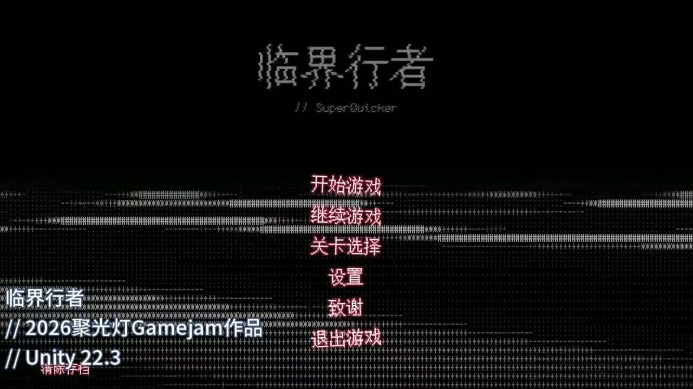
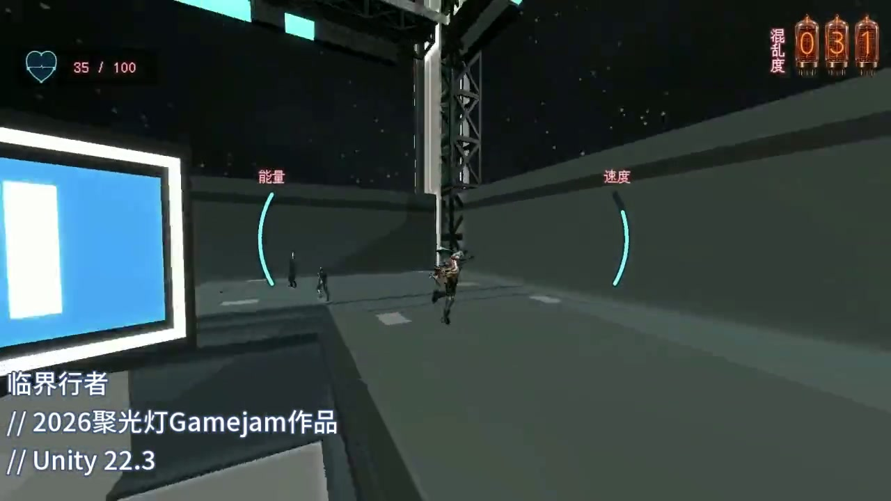
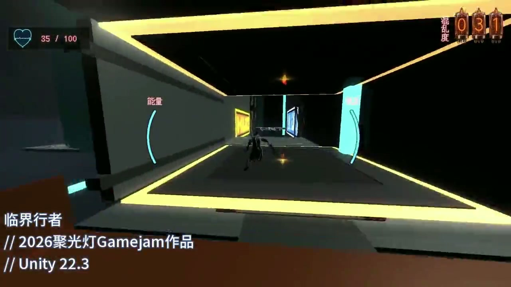
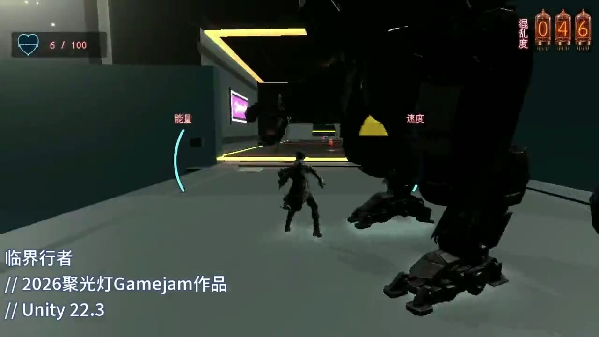

# 临界行者//SuperQuicker
> 聚光灯 GameJam 2026参赛作品。

## 游戏简介
“边跑边跳可以走得更快”，这是这个世界的法则。你从噩梦中醒来，发现自己身处一个完全不同的世界。身边不断涌现出的文字暗藏玄机，不仅蕴藏着这个世界诡异的法则，更暗示着不为人知的隐情。充分利用这个世界的法则前行吧，尝试逃离这个世界！

## 操作方法
WSAD移动，鼠标左键攻击，右键使用「矢量转换器」可以触发特殊技能，空格跳跃，Ctrl滑铲，Shift冲刺（特殊技能：长按右键触发时缓，右键+空格触发高跳，疾跑时右键触发加速）。

## 游戏规则
速度为核心，结合多个简单机制，在玩家的操作下，角色可以达成复杂的移动与攻击效果。从简单的几项法则里，千千万万条路线涌现出来——无论是利用地面进行连跳，还是利用冲刺凌空跃起，甚至是利用特殊技巧进行飞檐走壁，《临界行者》都能用它独具匠心的涌现式设计为玩家别处没有的高速动作体验。

是在原地徘徊，还是发现潜藏的秘密，继续前行？《临界行者》引入了独特的地图生成机制，玩家在看似循环的地图中探索，眼前掠过的景象表面相似实则不同。与主角一起思考、加速、飞跃吧！请你打破扮演角色、遵守指引、游玩游戏的刻板印象，在游玩的过程中发挥想象、尽情探索，尝试发掘出我们埋在《临界行者》中的所有秘密，在游戏与现实的临界状态里收获涌现出的专属记忆吧！

## 游戏截图

## 详情
- 制作团队 Echo Game Studio
- 发布时间 2026-10-20
- 游戏平台 Windows
- 体验时长 40分钟
- 开发时长 21天
